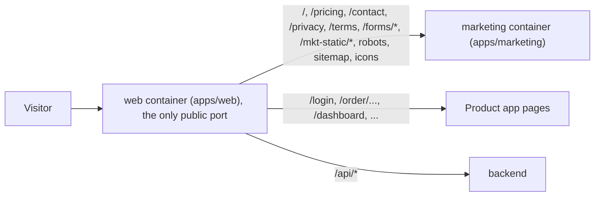

# YatriDesk marketing website

The public marketing site for YatriDesk: a one-page landing site plus Pricing, Contact/Demo, legal and 404 pages. Its job is to turn restaurant owners into demo requests and free-trial signups.

It lives in this monorepo as `apps/marketing`, next to the product app (`apps/web`) and API (`apps/backend`), and shares their tooling (pnpm workspaces, Turborepo, TypeScript, ESLint).

## Stack

| Purpose | Choice |
|---|---|
| Framework | Next.js 16 (App Router, Turbopack), React 19 |
| Styling | Tailwind CSS v4, design tokens in CSS variables |
| Animation | Motion (Framer Motion), loaded lazily; CSS for scroll reveals |
| Theming | `next-themes` (light / dark / system) |
| Forms | `react-hook-form` + Zod (same schemas on client and server) |
| Icons | `lucide-react`; product mockups are hand-built HTML/SVG, no images |
| Fonts | Sora (headings), Inter (body), Noto Sans Devanagari (Hindi), self-hosted via `next/font` |

## Run it locally

Requires Node 22+ and pnpm 11 (see the root `package.json`).

```bash
# from the repo root
pnpm install

# dev server on http://localhost:3002
pnpm --filter marketing dev

# production build and server
pnpm --filter marketing build
pnpm --filter marketing start      # http://localhost:3002

# checks
pnpm --filter marketing typecheck
pnpm --filter marketing lint
pnpm --filter marketing test       # validation + pricing unit tests
```

The product app usually runs on port 3000, so this site uses 3002.

### Environment variables (all optional)

| Variable | Used for | Default |
|---|---|---|
| `NEXT_PUBLIC_SITE_URL` | Canonical URLs, Open Graph, sitemap, robots | `https://yatridesk.cloud` |
| `NEXT_PUBLIC_APP_URL` | Where the "Login" link points (`<url>/login`). Leave empty on yatridesk.cloud, where the product app serves `/login` on the same domain. Set it to `http://localhost:3000` when running this site on its own locally. | empty (same domain) |

Both are `NEXT_PUBLIC_*` values, so they are fixed at build time.

### Running it together with the product app

This mirrors production:

```bash
# terminal 1: this site
pnpm --filter marketing dev                          # :3002

# terminal 2: the product app, forwarding the marketing paths to this site
# (PowerShell: $env:MARKETING_URL="http://localhost:3002"; pnpm --filter web dev)
MARKETING_URL=http://localhost:3002 pnpm --filter web dev
```

Then open the product app's URL. `/`, `/pricing` and the other marketing paths come from this site, while `/login` and everything else come from the product app.

## Project structure

```
app/                  routes (the "pages")
  page.tsx            home: sections in order
  pricing/  contact/  privacy/  terms/
  not-found.tsx       branded 404
  forms/demo/         POST demo request (placeholder: validates + logs)
  forms/integration-request/
  layout.tsx          fonts, metadata, JSON-LD, navbar/footer, floating UI
  opengraph-image.tsx apple-icon.tsx icon.svg robots.ts sitemap.ts manifest.ts
config/site.ts        ALL brand, contact, nav, pricing, stats, testimonials, FAQ data
styles/globals.css    design tokens (light + dark), Tailwind theme, utilities
sections/             one file per home-page section
components/
  ui/                 Button, Badge, Container, SectionHeading, Tabs, Accordion, Field, Icon, Logo
  layout/             Navbar, ResourcesMenu, MobileDrawer, Footer, FloatingCta, WhatsAppButton, CookieBanner
  mockups/            POS, kitchen display, phone, inventory, analytics, feature mini-visuals
  motion/             Reveal + RevealObserver (scroll reveal), Counter, DrawLine, MotionProvider
  forms/              DemoForm, IntegrationRequestForm
  i18n/               English/Hindi dictionaries, LanguageProvider, toggle
  seo/                JSON-LD helpers
lib/                  Zod schemas, pricing maths, analytics/consent stub, cn()
```

## Editing content

Almost everything you'll want to change is in **`config/site.ts`**:

- brand name, tagline and description
- contact details: phone, WhatsApp number and message, email, address, hours
- social links and the Login URL
- nav and footer links
- business types, used by the chips, Solutions tabs and the demo form dropdown
- pricing tiers: monthly prices, features, "most popular", the comparison table, and the yearly rule (`yearlyMonthsCharged`, default 10 = two months free)
- stats, testimonials, FAQ and integration categories

### Other places

- **Colours:** CSS variables at the top of `styles/globals.css`, with a `.dark` block for dark mode. `config/site.ts` mirrors the main hex values for the OG image and the manifest.
- **Headings and CTAs in Hindi:** `components/i18n/dictionaries.ts`. Body copy is English only.
- **Section copy:** the matching file in `sections/`.

## Deployment

### yatridesk.cloud (production setup)

The site runs at the root of **https://yatridesk.cloud**, on the same domain as the product app. Next.js calls this a ["multi-zone"](https://nextjs.org/docs/app/guides/multi-zones) setup:



How the pieces fit:

- **Forwarding:**
  - `apps/web/proxy.ts` forwards the marketing paths to this site when the web container has the environment variable `MARKETING_URL`.
  - It reads that variable at runtime, so the in-app "Update now" (which recreates the web container with the same settings) keeps the site in place.
  - Without the variable, every self-hosted install keeps the product's own landing page at `/`.
- **Assets:** this app's JS and CSS live under `/mkt-static` (its `assetPrefix` in `next.config.ts`), so they never collide with the product app's `/_next`.
- **Forms:** the form endpoints are `/forms/*`, not `/api/*`. The product app sends all of `/api/*` to the backend.
- **Links between the two apps** are plain `<a>` tags, so moving between them is a full page load. Next.js can't soft-navigate across zones. Examples: "Login" on this site, and the logo links back to `/` on the product's login, signup and docs pages.

**Deploy (Docker Compose):**

```bash
# on the server, from the repo root, with the usual .env
docker compose -f docker-compose.yml -f docker-compose.marketing.yml up -d --build
```

`docker-compose.marketing.yml`:
- adds the `marketing` service (built from `apps/marketing/Dockerfile`, internal port 3000, not published)
- sets `MARKETING_URL=http://marketing:3000` on the `web` service

Whatever already sits in front of the server (reverse proxy, Cloudflare, a hosting panel) needs no change, because visitors still reach only the web service.

If your host runs containers some other way (a hosting panel, Kubernetes, and so on), the equivalent is:
1. Run this image somewhere the web container can reach.
2. Set `MARKETING_URL=<that address>` on the web container.
3. Restart the web container.

**To check after deploying:**
- `https://yatridesk.cloud/` shows this site.
- `/login` and a table's `/order/...` QR link still open the product app.
- `https://yatridesk.cloud/robots.txt` and `/sitemap.xml` load.

**Updating the site:** rebuild and restart only the marketing container:

```bash
docker compose -f docker-compose.yml -f docker-compose.marketing.yml up -d --build marketing
```

**Adding a new top-level page** (for example `/blog`): also add the path to `config.matcher` in `apps/web/proxy.ts`, otherwise the product app will answer it.

### Elsewhere (Vercel, Netlify)

The site is fully static except the two form routes, so it can also run on its own domain on any Next.js host.

### Vercel

1. Import the repository.
2. Set **Root Directory** to `apps/marketing`. Vercel detects Next.js and the pnpm workspace on its own.
3. Leave the default install (`pnpm install`) and build (`next build`) commands.
4. Add `NEXT_PUBLIC_SITE_URL` (for example `https://www.yatridesk.in`) and `NEXT_PUBLIC_APP_URL`.
5. Deploy, then point your domain at the project.

### Netlify

1. Import the repository and set **Base directory** to `apps/marketing`. Netlify's Next.js runtime is applied automatically.
2. Set the build command to `pnpm --filter marketing build` and the publish directory to `.next`.
3. Add the same environment variables, then deploy.

### Before going live

- Connect the form endpoints in `app/forms/demo/route.ts` and `app/forms/integration-request/route.ts` to your CRM, email or the YatriDesk backend. They currently only validate and `console.info` the lead.
- Load your analytics in `loadAnalytics()` in `lib/analytics.ts`. It already runs only after the visitor accepts cookies.
- Run Lighthouse / PageSpeed Insights against the deployed URL.

## Quality notes

- **Accessibility:**
  - semantic landmarks, a skip link and one `h1` per page
  - visible focus rings and 44px minimum touch targets
  - ARIA tabs with arrow keys, Home and End
  - a disclosure accordion
  - a keyboard-friendly Resources menu (arrows and Esc)
  - native `<dialog>` for the mobile drawer and the tour video (focus trap and Esc)
  - form errors linked with `aria-describedby`
  - every text colour pair checked for WCAG AA
- **Motion:**
  - `prefers-reduced-motion` is respected everywhere: Motion's `reducedMotion="user"`, CSS overrides, and scroll reveals off.
  - Content stays visible without JavaScript.
- **Performance:**
  - mostly server components; Motion features load lazily
  - one shared IntersectionObserver for scroll reveals
  - `content-visibility: auto` on below-the-fold sections
  - no images apart from the generated icons
  - zero layout shift
- **SEO:**
  - per-page metadata, canonical URLs, Open Graph and Twitter cards
  - a generated OG image, robots.txt, sitemap.xml and web manifest
  - JSON-LD for `SoftwareApplication` (offers come from the pricing config) and `FAQPage`
- **Lighthouse on a local production build:**

| Run | Performance | Accessibility | Best practices | SEO |
|---|---|---|---|---|
| Desktop | 93–96 | 100 | 100 | 100 |
| Mobile (simulated slow 4G, 4× CPU) | 50–71 | 100 | 100 | 100 |

  The mobile performance range varied with the local machine's load, so re-check it on the deployed URL with PageSpeed Insights.

## Placeholders to replace before launch

Everything below is a placeholder. Visible placeholders are labelled on the page, so nothing is presented as real.

| What | Where |
|---|---|
| Stats ("500+ outlets", etc.), shown with a "Placeholder figures" badge | `config/site.ts` → `stats` (set `placeholder: false` when real) |
| Testimonials, labelled "Sample" | `config/site.ts` → `testimonials` (set `placeholder: false` when real) |
| Prices ₹799 / ₹1,499 / ₹2,999 and the 2-months-free yearly rule, with a "Sample prices" note | `config/site.ts` → `pricing` |
| Phone `+91 90000 00000`, WhatsApp `919000000000`, email `hello@yatridesk.example`, address, hours | `config/site.ts` → `contact` |
| Social profile URLs | `config/site.ts` → `social` |
| "Watch 2-min tour" video (currently a "being recorded" panel) | `config/site.ts` → `tourVideoUrl` |
| Resources links: Blog, Help centre, GST guide (marked "Coming soon") | `config/site.ts` → `nav.resources`, `footer.resources` |
| Demo and integration form destinations (log only) | `app/forms/*/route.ts` |
| Analytics script | `lib/analytics.ts` → `loadAnalytics()` |
| Privacy policy and terms text (needs legal review) | `app/privacy/page.tsx`, `app/terms/page.tsx` |
| OG image tagline | `app/opengraph-image.tsx` |
| Sample GSTIN shown in a product mockup | `components/mockups/MiniVisuals.tsx` |
